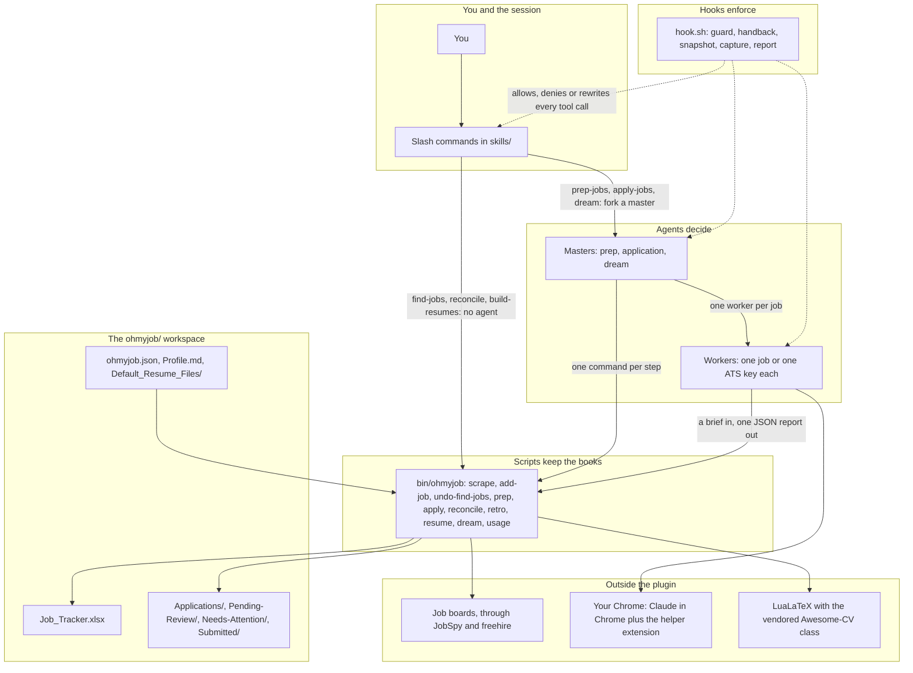
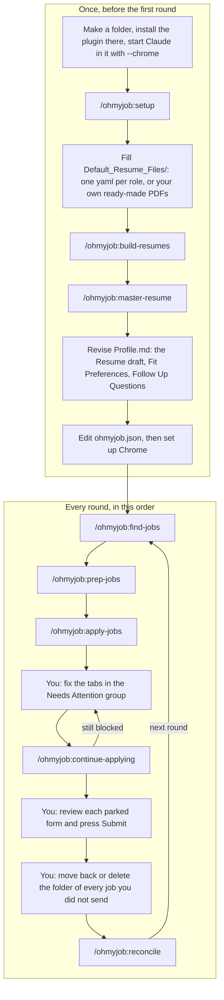
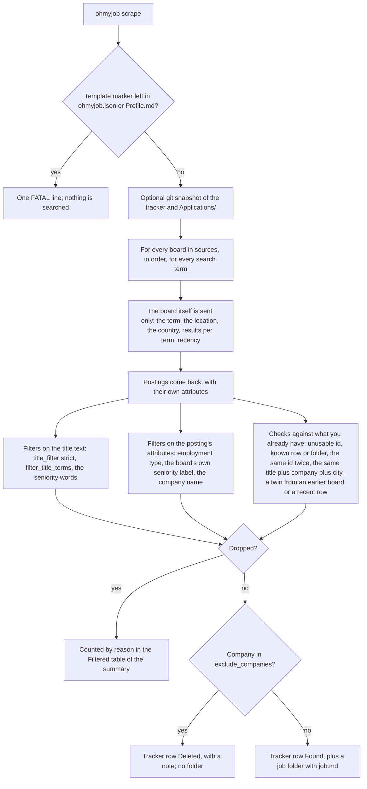
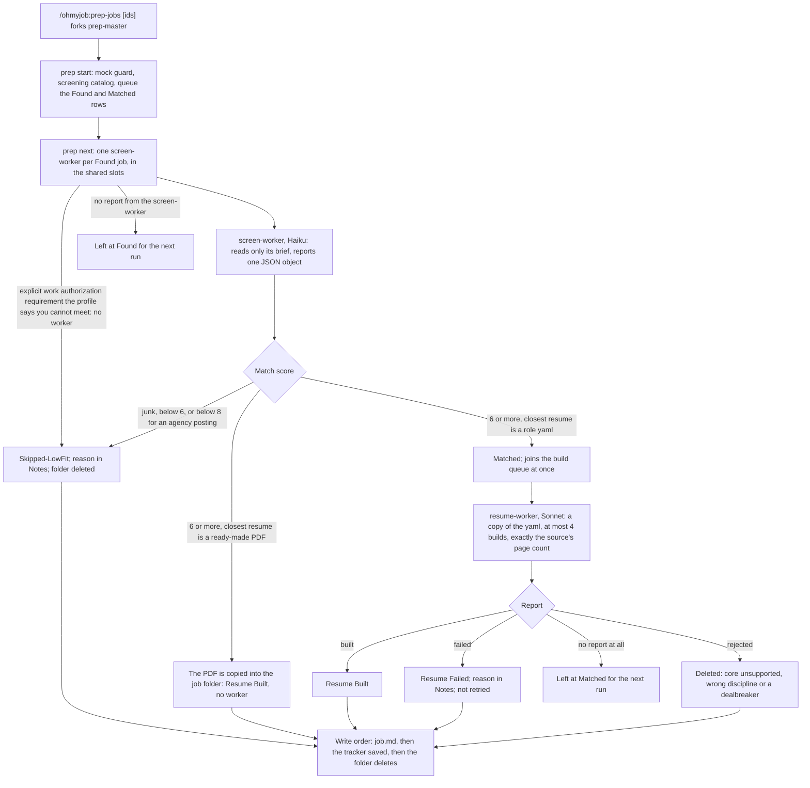
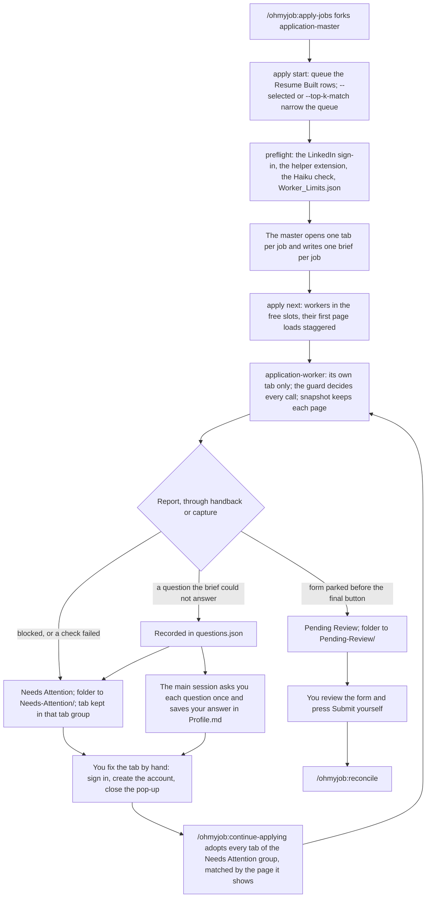
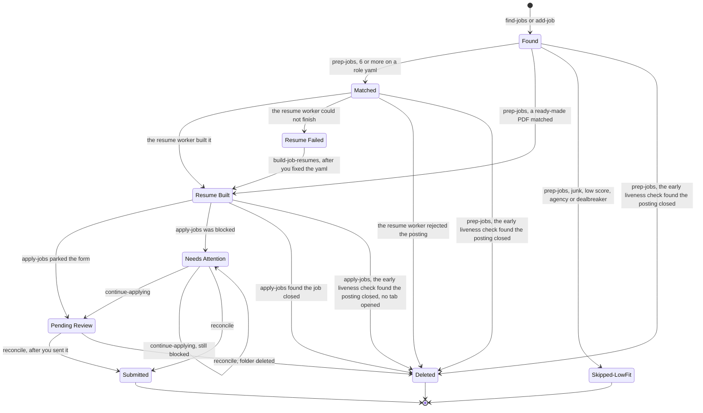
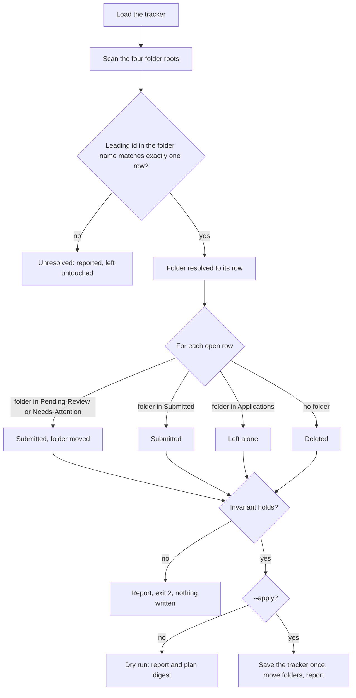

# Architecture

How ohmyjob is put together: the layers, the four subsystems, the hooks that bind them and the state they share.

## Principle: agents decide, scripts keep the books, hooks enforce

- **Agents (LLM)** judge and act: a master runs the steps and starts workers; each worker handles one job.
- **Scripts** do all bookkeeping: queues, briefs, result checks, job notes, folder moves, tracker rows, follow-up questions, cleanup. A master calls them through one command, `ohmyjob`.
- **Hooks** run on every tool call they match; an agent cannot skip them. They allow, refuse or rewrite a call and save what the scripts need.

`prep-jobs`, `apply-jobs`, `continue-applying` and `dream` fork a master, which starts the workers. `find-jobs`, `undo-find-jobs`, `reconcile` and the two resume builds are scripts the main session runs directly. Every tool call of all of them passes the hooks.

## How you use it

The three by-hand steps of a round are the design, not a gap: the plugin cannot submit a form, and `reconcile` cannot tell a form you sent from one you only looked at, so the folder clean-up before it is what keeps the tracker true.

## Components

### Skills (`skills/`, commands are `/ohmyjob:<name>`)

| Skill | Role |
|---|---|
| `setup` | Idempotent preparation and health check: version gate, plugin-scope and Chrome checks (Chrome is a warning only), bootstrap (scoped installs, the `ohmyjob/` skeleton, mock templates, `Template.pdf`), extension steps, then it prints what the user fills in. It never interviews and never writes the user's data. |
| `master-resume` | Runs `ohmyjob resume master`: a script merges the resume yamls and extracts PDF text into a draft of `# Resume`; Claude adds the PDF facts; `--apply` saves it into Profile.md after a backup. |
| `build-resumes` | Runs `ohmyjob resume build-all`: a PDF next to every yaml in `Default_Resume_Files/`; reports `OK` or `FAIL` per file (never `Template*.yaml`; an optional file name builds only that file). Never edits a yaml. |
| `edit-template` | Changes the LaTeX template from a request in words: decides resume, CV or both (asks when the words and the user's yamls do not say), edits the workspace copy `Resume_Template/resume.tex.j2` (made by `ohmyjob resume template`), adds sample lines to `Template*.yaml`, and builds both templates to prove they compile (it resets the copy when a fix fails). Never edits the Awesome-CV class, a script or a role yaml. |
| `help` | Reads the plugin README and `docs/SETTINGS.md` and prints the commands with their use-cases, the `ohmyjob.json` field table and the job status life cycle. The model may invoke it. |
| `find-jobs` | Runs `ohmyjob scrape` in the background and summarizes (also usable from a scheduled `claude -p`). |
| `add-job` | Puts postings the candidate found by hand into the tracker at `Found`: web addresses go straight to `ohmyjob add-job`. Never writes the tracker or a folder itself; never starts stage 2. |
| `undo-find-jobs` | Dry run, confirmation, then `--apply --expect <digest>`: removes the `Found`/`Deleted` rows of the latest find run and their `Applications/` folders, after copying the tracker to `.ohmyjob/backup/Job_Tracker-<UTC>.pre-undo.xlsx` (the next `/ohmyjob:reconcile` deletes it). |
| `prep-jobs` | Forks the `prep-master` agent; optional job ids limit it to those jobs (`prep start --ids`). |
| `apply-jobs`, `continue-applying` | Thin skills in the main session: call their `-run` skill, then ask the collected follow-up questions in one message and save the answers (`apply-jobs` first asks for the missing `# Work Authorization` lines). |
| `apply-jobs-run`, `continue-applying-run` | Internal; fork the `application-master` agent (the second in continue mode). |
| `reconcile` | Caveat check, dry run, confirmation, then apply. The apply also deletes `questions.json`, so unanswered follow-up questions do not carry into the next round, and deletes the `Job_Tracker-*.pre-undo.xlsx` backups of `undo-find-jobs` (the dry run lists them). |
| `build-job-resumes` | Runs `ohmyjob resume build-jobs "<names>"`: the tailored resume of each named job folder, built again and set back to `Resume Built`. |
| `dream` | Forks the `dream-master` agent: the traces since the last dream become the ATS notes of the workspace. |
| `retro` | Runs in the main session, no agent (it is a conversation, like `apply-jobs`): the candidate marks recent skips as wrong and types preferences; the session drafts edits of the three Fit Preferences fields; `ohmyjob retro` checks, shows and writes them one at a time after the candidate's yes. |

### Agents (`agents/`, named `ohmyjob:<name>`)

| Agent | Model | Job |
|---|---|---|
| `prep-master` | Haiku | Loops on `ohmyjob prep next` and starts the workers it prints. Cannot read files or pages. |
| `screen-worker` | Haiku | Scores one job against the text catalog of the usable resumes; reads only its brief; reports one JSON object. |
| `resume-worker` | Sonnet | Tailors one resume yaml (or rejects a mis-matched posting before any edit); the only command it may run is the build of its own job. |
| `application-master` | Haiku | Runs the apply steps through `ohmyjob apply` and starts workers; its browser tools are limited to tab handling and the sign-in check. |
| `application-worker` | Haiku | Fills one application in one assigned tab, from its brief; stops before the final button; reports one JSON object. A stuck first attempt is taken over once by a Sonnet worker (see stage 3). |
| `dream-master` | Opus | Runs `ohmyjob dream start/next/finish/end` and starts one host worker per ATS key. Reads no file. |
| `dream-host-worker` | Sonnet | Writes ONE ATS note of the workspace from the evidence bundle of its key. Reads its bundle, the notes and the application worker's rules; writes only its own note. |

Plugin agents ignore `permissionMode`, so a hook returns an explicit allow for every call it has validated. The `tools: Agent(...)` entry in an agent's frontmatter does not restrict what it can start, so the guards check the requested agent type themselves.

### Scripts (`scripts/`, run through `bin/ohmyjob`)

| Command | Script | Job |
|---|---|---|
| `ohmyjob scrape` | `scrape.py`, `scrape_core.py` | Search, filter, dedupe, write job folders and tracker rows. |
| `ohmyjob add-job` | `add_job.py` | Add postings found by hand: fetch the page, read its schema.org JobPosting, check what is known (id, twin), write the folder, `job.md` and the `Found` row. No search filter applies. |
| `ohmyjob undo-find-jobs [run] [--apply --expect D]` | `undo_find_jobs.py` | Remove the rows of one find run (by `Date Found` prefix, default the newest date) that are still `Found`/`Deleted`, and their `Applications/` folders; dry run first, tracker backup before the write. |
| `ohmyjob prep <cmd>` | `pj.py` (hooks: `pj_hooks.py`) | Prep queue, briefs, yaml checks, build, records. |
| `ohmyjob prep <cmd>` | `pj.py` (hooks: `pj_hooks.py`) | Prep queue, briefs, yaml checks, build, records. `work_auth.py` is its work authorization pre-pass. |
| `ohmyjob apply <cmd>` | `aa.py`, `aa_lib.py` (hooks: `hooks.py`; `judge.py`, `lexicon.py`) | Apply queue, briefs, result checks, tab groups, questions. `gaps` and `authorize` (main session only, not the master) ask for and write the `# Work Authorization` lines before a run. |
| `ohmyjob reconcile` | `reconcile.py` | Tracker versus folders; `--apply` also clears `questions.json`. |
| `ohmyjob resume build`, `build-all`, `build-jobs` | `resume_build.py` | Render one yaml (or every yaml of a folder except `Template*.yaml`, or the one named) to LaTeX, run `lualatex`, count pages. `build-jobs "<names>"` builds the single yaml of each named job folder and sets its row to `Resume Built`. The template is the workspace copy `Resume_Template/resume.tex.j2` when it exists, else the plugin's `resume/resume.tex.j2`; the template also gets the raw yaml as `data`. |
| `ohmyjob resume template [--reset]` | `resume_build.py` | Make the editable copy of the template in the workspace (never overwrites it); `--reset` deletes it. |
| `ohmyjob dream <cmd>` | `dream.py` (with `ledger.py`) | Group the new traces by ATS key, hand out one worker per key, check the notes, write `Dream_Report.md`, move the watermark; `reject` restores the last backup. |
| `ohmyjob usage` | `usage_log.py` | Prints `.ohmyjob/usage.jsonl`, the cost log that `prep end` and `apply end` append to (one line per run: total and the cost per kind of work, with the cost per unit of work derived when printed; written by the same `run_costs` that prints the end report). |
| `ohmyjob retro <cmd>` | `retro.py` | `start`, `list`, `mark`, `feedback`, `propose`, `accept`, `refuse`, `end`, `reject`: the review state, the watermark (reviewed job ids), refused proposals, the structure guard and the single-field write of `Profile.md`; also the one-line hint at the end of `prep end`. Reads the tracker, never writes it. |
| (internal) | `ledger.py` | Blocker codes, outcomes, the ledger lines and the redacted traces that `ohmyjob apply end` writes. |
| (internal) | `liveness.py` | The early liveness check, called by `prep start` and `apply start`: GETs a queued job's page with the scraper's own session and says closed (positive evidence only), open or unknown. One request at a time per host with a pause, a stop for a host after 3 refusals in a row, a 40 second budget; nothing is kept between runs. `OHMYJOB_NO_LIVENESS=1` turns it off (the tests do). |
| (internal) | `workspace.py`, `tracker.py`, `job_key.py` | Config and paths, the xlsx tracker, the one job-id rule. |
| (internal) | `hook.sh`, `bootstrap.sh`, `merge_settings.py`, `pii_gate.sh` | Hook router, environment setup, the workspace settings merge, release check. |

`bin/ohmyjob` finds the workspace, reads `.ohmyjob/env.sh` (parsed, never sourced) and runs the script with the plugin's own virtualenv. Errors are one `ohmyjob: ...` line (exit 3); the scripts print `FATAL ...` lines. Agent prompts stop on either.

### Stage 1 — Job Posting Finder (`ohmyjob scrape`)

For each board in `search.sources`, in order, JobSpy is asked for every search term. A posting is kept when its title matches a term (word forms and aliases applied, or any title with `title_filter: off`), its employment type and company pass, it does not read as spam (`junk_reason`: scam, MLM or chat-app signals), it is not known yet (tracker row or a folder with the same job key) and it is not a twin of a posting from an earlier board or of a recent tracker row. Each new job gets `Applications/<key>_<Company>_<Title>/job.md` and a tracker row at `Found`. A board that fails is reported (`WARNING <board>: ERROR ...`) and the others run; rows from the terms that did succeed are kept. The run is fatal only when every board failed and nothing came back.

A posting the candidate found by hand enters the same stage through `ohmyjob add-job` (`/ohmyjob:add-job`): the same `job.md` and `Found` row, `Source` `Added by hand (<site>)`, and the checks against what is already there (`known`, `twin`; every row counts, whatever its age or status, and the existing row is named). None of the search filters applies, and a company in `exclude_companies` only gets a warning. The page is fetched by the script (standard library, no Chrome) and read from its JobPosting data; a page that cannot be read (error, sign-in wall, script-rendered, empty or boilerplate-only text) creates nothing and is reported. A company or title that the page does not tell is never guessed: nothing is created.

The drop checks run in one fixed order, and the first one that hits wins: `bad`, `known`, `dup id`, `failed` (a LinkedIn detail page that did not load), `type`, `lang` (freehire only: the posting's language label is not one the `# Languages` section of `Profile.md` names; unlabeled rows and a profile without the section never drop), `level`, `term`, `title`, `junk`, `duplicate`, `twin_tracker` (a recent tracker row), `twin_board` (an earlier board).

### Helper extension (`chrome-extension/`)

A small MV3 extension. In a run's tab group it opens page pop-ups (sign-in windows) as tabs, which Claude in Chrome can then control; it names icon-only controls (links and clickable icons too): an icon-only Google logo becomes "Continue with Google", and any other control with no name gets one read off its icon, from an svg `<title>`, a sprite id, a `data-testid` or the one class that is no framework prefix, hash or styling word. A control with a `title` attribute, or with an image that carries an `alt` inside it, is left alone: `read_page` names it from the title and shows the image's `alt` as a line inside it, and the guessed name would go into `aria-label`, which outranks both — a trash button with `title="Delete"` and `class="trash"` would reach the guard as "Trash", with the word it refuses on gone. Since helper 1.14.0 it also gives `role="button"` to a `div` or `span` that carries an `onclick` or a `tabindex` and has no role of its own: `read_page` lists elements by role, so such a control was invisible to the worker however clickable it was, and with a role `read_page` names it from its own text (an icon-only one goes through the same icon naming). Candidates are found by attribute alone, never by `getComputedStyle` over the document, which froze big forms; a `div` whose handler is on `addEventListener` and whose pointer cursor comes from a class therefore still has neither attribute and is not covered. A role it wrote is taken back when the run ends, and the site's own role is never replaced. Every name it writes is prefixed `[icon] `, so the guard can tell a guess from a name the site wrote; a name it wrote is taken back as soon as it no longer applies (the button now has text of its own) and again when the run ends, and it never replaces a name the site gave. It also writes how many Google controls a job page has into its title (`[AA g=N named=M]`, which the ledger uses); and at the end of a run it moves finished job tabs into the tab groups "Pending Review", "Needs Attention" and "Deleted". For `continue-applying` it moves EVERY tab of the group "Needs Attention" back, in any window, also tabs the candidate put there by hand. Its content scripts (`bridge.js`, `page.js`) load on every page and frame, but act only in tabs of the run group. The helper's Google-button naming and its `g=` count skip app-store badge links (play.google.com, apps.apple.com, itunes.apple.com) and the icon holders inside them, and only frames whose src starts with https://accounts.google.com/gsi/ count as Google's own sign-in widget (helper 1.10.1). Since helper 1.11.0 it also puts a proxy over each control inside an open shadow root (see "Shadow DOM" under the guards). Since helper 1.15.0 a Google button inside a frame too small to be linked gets an invisible overlay named `Continue with Google` in the page above it (see "Frames" under the guards).

### Resume build (`resume/`, `resume_build.py`)

One complete yaml per resume (no shared base file; `Template.yaml` is the annotated starting point) is rendered through `resume.tex.j2` and compiled with LuaLaTeX using the vendored Awesome-CV class, in its own directory per build so parallel builds do not collide. The result is `OK`, `OVERFLOW` (a tailored resume with more pages than its source resume's PDF; a build with fewer pages is a check failure asking to keep the original length) or `FAIL`; character budgets for bullets and skill rows are checked before compiling. Every build uses `texmf-var/` in the plugin data folder for the LaTeX font caches.

## Hook routing and the guard model

Hooks are declared in `hooks/hooks.json` and all enter through `scripts/hook.sh <event>`:

| Event | Fires on | Does |
|---|---|---|
| `guard` | PreToolUse of Chrome tools, Read, Edit, Write, Bash, Agent | Allow, deny or rewrite. |
| `handback` | PreToolUse of `SubagentHandback` | Checks a worker's report; refuses a bad one (twice at most). |
| `snapshot` | PostToolUse of Chrome tools | Saves each page and its element refs; compacts long pages for the application worker. |
| `capture` | SubagentStop of an ohmyjob worker | The same report checks on the worker's final text. |
| `report` | Stop | Prints the saved cost report once, then deletes it. Runs 2 to 3 times per run; only the first has a report to print. |

A worker's report reaches the scripts by two equal paths, `handback` (auto mode only) and `capture` (the only path in Manual and `-p` mode). Both feed one processor.

Routing rules, in order:

1. **Workspace discovery** is one walk-up rule for `find_root`, `hook.sh`, `bin/ohmyjob` and the Python hooks: `$OHMYJOB_WORKSPACE` as given (tests; `find_root` and `bin/ohmyjob` only, the Python hooks never read it), else walk up from the start folder (the hooks: the call's `cwd`, else the project folder; `find_root`: the project folder, else the shell's `cwd`); in each folder D, `D/ohmyjob.json` makes D the workspace, else `D/ohmyjob/ohmyjob.json` makes `D/ohmyjob` the workspace. So the project folder and a shell inside `ohmyjob/` both work.
2. `hook.sh` stays in bash and starts no Python unless it must. Outside a workspace it exits 0 with no output.
3. A `guard` of any Chrome tool goes to `hooks.py`, whoever calls. The main session and non-ohmyjob subagents get the rules for callers outside the pipeline: no `javascript_tool`; clicks only on refs from a fresh read of that tab, one pressable click per read; no coordinate clicks; keys only from an allowlist (Tab, Shift+Tab, Escape, Backspace, Delete, arrows, Home, End, Page keys, Ctrl/Cmd with A, C, V, X, Z, Y); navigation to http(s) addresses only; no Apply click on a job board or under a filled form; final button names checked by the word lists.
4. Other calls with a prep agent type go to `pj_hooks.py`; with an application agent type go to `hooks.py`. The main session's non-Chrome calls and other agents' non-Chrome calls cost nothing.
5. The model controls `tool_input`, so the Python hooks decide only from the parsed top-level `agent_type`, `tool_name` and `cwd`, never from text inside `tool_input`. Each script re-checks the parsed agent type and hands over to the other when the prefilter picked wrongly.
6. Without the plugin's virtualenv, `guard` of any ohmyjob agent and of any Chrome call by an agent is denied with `ohmyjob: environment missing or stale, run /ohmyjob:setup`; the main session's Chrome call only gets a notice (fail-open, because no pipeline can run before setup). The guard is `onFailure: block`, so a crash blocks the call too.

What the guards enforce:

- **Prep agents** stay inside their own job: a screen worker reads only its brief; a resume worker reads its brief, yaml and PDF, edits only its yaml and runs only the build of its job. A master may start only its own worker types.
- **Frames**: `read_page` cannot see into any frame, so the helper extension puts a 1x1 link `"[AA frame]"` beside it whose `href` is the frame's own address (frames of at least 200x200 only). A link, because `read_page` cuts a name at 100 characters and such an address carries a token, while it prints an `href` whole. The address comes from the frame's `src`, and from the frame itself: in a run group every frame posts its own `location.href` to the page above it, which matches the sender's window to one of its frames before it believes it. That covers a frame its own script navigated and a `srcdoc` frame, neither of which has an `src` worth following. When a frame still has no address, any attribute of its own whose **name** holds `src` as a word is tried (`data-src`, `data-cookieblock-src`, `uc-src` and the rest; helper 1.12.2): a consent tool that blocks an embed until the visitor agrees keeps the real address there, and offering it gives no consent. The name must hold `src`, because the worker navigates its tab to that address and a scan of every URL-valued attribute would offer it a poster image or a tracking beacon as the form; a word rather than a substring, because `srcdoc` holds a document and not an address. A banner with only "Accept all" is still refused, and no consent-tool element is hidden. A `ResizeObserver` watches each frame as well: a frame is often small while the page is built and is sized to its form afterwards, by style alone, which is no change of the tree. Reloading the extension does not reach a tab that is already open, and `/ohmyjob:continue-applying` adopts exactly such tabs, so `adoptTabs` injects the current `bridge.js` into each one (`scripting`); a document runs one copy only, by the version it writes on `<html>`. A job tab's tag carries that version (`[AA g=N named=M v=X]`), and `AA adopted` reports a tab whose copy is older than the plugin's as `stale_helper`. The worker navigates its tab there and fills the form as a page of its own; `NOT_ACCESSIBLE` is for a page with no such name after an "all" read. `greenhouse_form_url` stays as a fast path for the addresses it can read the posting id from. `read_page` reads no frame at all, same-site, `srcdoc` and `about:blank` ones included, so a same-origin frame gets its link too (its address from `contentWindow.location.href`). A frame with no address of its own (`srcdoc`, `about:blank`, written by the page) inherits the page's origin, so its document can be read from the frame above it: the bridge looks inside such a frame, up to two levels down, and takes the address of the first frame of at least 200x200 inside it that has one (helper 1.12.1), because the form usually sits one level deeper and the inner frame's own marker is written into a document `read_page` cannot enter. A big inner frame with no address of its own is skipped, not taken. Inside such a frame only the `src` attribute is read (resolved against that frame's own document, not this page), so an inner frame that only its own script navigated is not covered, and a frame the page builds after the last pass keeps its `[AA frame: no address]` tag until the next trigger. Only when that finds nothing either does a frame of 200x200 or more with no usable address get an `<a data-aa-frame="none" aria-label="[AA frame: no address]">` without `href` (an `<a>` without `href` still shows in the interactive view); a frame that later gets an address turns its tag into a link. **Small frames (helper 1.15.0)**: a frame under 200x200 gets no link, yet a social-login widget such as OneAll's (352x120, "Login with Social Networks") holds a Google button that `read_page` cannot reach. It is not linked, because the worker would load the widget as a top-level page, where it has no parent window to post the sign-in result to, so the application site would never learn the candidate signed in; and lowering `FRAME_MIN` is no answer either (a 1x1 tracker frame must stay unmarked). Instead the frame reports the box of its first Google control (found with `hasGoogleIcon`, like the naming pass) to the page above it as `{ aaGoogle: {x, y, w, h} }`, on the same triggers as its address, and the page, after the same window-identity check, lays ONE `<button data-aa-google-frame>` over that box (frame position + box + scroll), styled like the shadow proxies (`opacity: 0.01`, `pointer-events: none`) and named with the literal `Continue with Google`: no `[icon] ` prefix, because the guard's final-control rule excepts exactly that literal, and no `[AA ` marker, because the guard refuses every click on one. Claude in Chrome clicks the ref by screen coordinate, which passes through the overlay to the real button. Only a frame that is not `bigEnough` gets one. The overlay counts in `g=` and `named=` (it is a real Google control of the page, and the button in the frame is invisible to the page, so nothing is counted twice). It is placed in the naming pass, with no scroll or resize listener, so a scroll with no DOM change leaves it where it was until the next trigger (known gap, same as the shadow proxies). Leaving the run group removes every overlay.
- **Viewport**: `read_page` with `filter: "interactive"` lists only the elements in the current viewport; `filter: "all"` lists the whole page (up to `aa_lib.COMPACT_CAP`, 40000 characters). A control below the fold is missing from the interactive view, so the worker doc tells it to read with `filter: "all"` before it reports `NO_APPLY_CONTROL` or `NOT_ACCESSIBLE`.
- **Shadow DOM**: `read_page` does not enter a shadow root, so a form built from web components (SmartRecruiters' `spl-*` elements) looks empty. The bridge (top frame, run-group tabs, helper 1.11.0) walks every OPEN shadow root and puts a light-DOM proxy over each interactive control in it, all inside one `
` at the end of `<body>`. Flattening the shadow DOM was rejected: such a page has thousands of slots and adopted style sheets. A proxy is an `input` (same `type`), `textarea`, `select` (options cloned), `button` (same `type`, so a nameless one is still a submit button that the guard refuses), `a` (same `href`), or a `div` with the same `role`, absolutely placed over the real control with `opacity: 0.01` and `pointer-events: none`. The opacity is not 0 because `read_page` skips an element with opacity 0; `pointer-events: none` makes Claude in Chrome's coordinate click pass the proxy and reach the real control, and lets the candidate use the page by hand. What a coordinate cannot carry is forwarded: `input` and `change` on a proxy (`form_input`, `file_upload`) set the real value or files through the native setter and fire the event on the real control; a programmatic `click` is forwarded only while the real control's name is still the one the proxy carries. Only controls within one viewport of the visible area get a proxy (a long country list must not flood the view), at most 200 per pass, so the worker scrolls and reads again. The name is the real control's: its `<label>`, `aria-label`, `aria-labelledby`, own text, then the text of its shadow host, with text collected across shadow boundaries, cut at 80 characters; a control with no name stays nameless (never an `id` or tag name); a name never starts with `[AA ` (a space is put before it); a second proxy of the same name gets ` (2)`, ` (3)`. The raw name is in `data-aa-shadow-name`, and `aria-label` is rewritten only when that changes. The proxies are ordinary light-DOM controls, so `markFields` marks them (`[req] <name> = <value>`) in the same pass, which runs the shadow pass first. A `MutationObserver` per discovered shadow root, and a `scroll` listener, schedule the pass. Leaving the run group removes the container.
- **Field marks**: `read_page` prints no checked, pressed, required, invalid or disabled state, names a textbox by its value and a radio by its `value` attribute. In a run-group tab the bridge therefore sets the `aria-label` of choice controls (checkbox, radio, switch, custom option) and text-type controls to `<marks><name>`, marks in the order `[hidden] ` (helper 1.12.0; text-type controls only: `checkVisibility` false, i.e. `display:none` or `visibility:hidden`, a zero-size box, or a box entirely off the document, not the viewport, so a field below the fold or scrolled away is not marked; `opacity: 0` is excluded on purpose because real controls are styled that way, and a choice control is never marked), `[x] ` (checked or selected), `[req] `, `[disabled] `, `[invalid] `, cut at 100 characters. The guard refuses `form_input` on a text-role ref carrying `[hidden]` (`parse_refs` records `item["hidden"]`) or an `input type=hidden`, on the agent path and in `ForeignCall.field_tool`, because a filled honeypot flags the application as spam without any sign; `file_upload` and tick roles are untouched. A revealed field loses the mark because a section is opened by a click and a click schedules a pass; `hidden` is watched too, while `style` and `class` are not (a page that rewrites them all the time would run a pass, and its box reads, every second in every worker tab), so a field revealed by a timer alone keeps a stale mark until the next trigger, which refuses a fill rather than allowing a wrong one. A text field reads `<label> = <value>` (value cut at 40, never a password); a radio reads `<question> / <option>` (fieldset legend, radiogroup label or the table row's first cell). Buttons and links get no label (a late pass would otherwise leave a stale name on a button whose text changed), and a label is never marks alone. The site's own label is kept in `data-aa-orig-label`; it is restored when the base name came from the site's own label or is empty and no mark is left, and otherwise the improved label stays. It runs in the top frame only, in the 150 ms debounced pass (run at once when the first pending trigger is older than about 1 s, so a busy page cannot starve it), after `change`, `input` and `click`, and after attribute, `characterData` and child-list changes (never watching `aria-label`); one control-to-label map is built per pass. The guard strips the marks once in `aa_lib.parse_refs` (which also splits a text field's value off its label into `value`, so fills, fingerprints and the ledger see labels only, and flags `[AA ` names as markers that `final_controls` skips) (and in `line_name`, `context_names`, `question_labels`), so every rule sees the page's own name; the worker's compact view keeps them. A click on a text-type field skips every name rule of `check_click_name`; tick roles (not `option`) skip the permission (2, 10), delete (11), sign-up (12) and Google (13) rules; a click, hover, `form_input` or `file_upload` on a ref named `[AA ...]` is refused. `ledger.redact_text` masks the value of every quoted `"<label> = <value>"` name.
- **Dialog shim** (`page.js`, every frame, run-group tabs only): `alert` shows no dialog, `confirm` returns `false` and `prompt` returns `null`, and each writes an `<a data-aa-dialog>` without `href` (`[AA alert] <message>`, `[AA confirm: answered Cancel]`, pointer-events none, fixed at the top) that the interactive view lists; a `beforeunload` listener drops "Leave site?" prompts. The replacements are installed lazily, only while `<html>` carries `data-aa-popups-as-tabs` (each wraps whatever `alert`, `confirm` or `prompt` stood there when the attribute appeared, and puts that function back when the attribute goes, only while its own override is still in place, so a site's own replacement is kept), so other sites keep their functions; the `beforeunload` listener stays from document start. Known limit: a child tab that is taken out of the run is pulled back into its opener's run group on its next page load. The banner is dropped at the next trusted click or key press, and on leaving the run. A note written in a frame stays in that frame's document, so a frame cannot forge banners in the page above it. At the end of a run `makeGroups` injects the bridge and sends `aa-recheck` to each moved tab, and a `tabs.onUpdated` change of `groupId` sends it too (so moving a tab out of its group by hand also ends the run in it): the bridge then leaves the run group (removes `data-aa-popups-as-tabs`, stops marking), so parked tabs get native `alert`, `confirm` and `beforeunload` back; `adoptTabs` makes the bridge run one full pass again.
- **Application worker**: only its own tab (and its sign-in tab); no coordinate clicks, no key outside the same allowlist (so no Space, and no Enter or Return unless the focused ref is a `combobox` or `searchbox`: `enter_in_search_list`), no JavaScript; every click carries a non-empty action note (`action_summary`; the worker prompt asks for English) and a note that says the click sends the application is refused; refs of an old page are refused, also after navigate back or forward (the page state of the tab is voided, and the new address is taken from the tool result); a second click on a pressable element (not a choice or text field) already clicked since the last full page read is refused; a worker that has read its brief can only use the job tab of that brief, never a sibling's tab that is still unclaimed; typing only after a click on a text field, with no control character (a `\n` only into a `textarea` or a `textbox` with `aria-multiline="true"`: `multiline_box`); uploads of one path per call, the job's own resume or another existing file in that resume's folder (the resolved path's parent must equal the resume's parent); reads only its brief and the ATS notes in `ats/`.
- **Mock guard**: `scrape` refuses while `ohmyjob.json` or `Profile.md` holds the `OHMYJOB-TEMPLATE` marker; `prep start` while `Profile.md` holds it or no usable resume is left; `apply start` (also continue mode) while `Profile.md` holds it; `add-job` while either file holds it. The check is one helper, `has_template_marker` / `template_files` in `workspace.py`. Each refusal is one `FATAL:` line naming the file.
- **Final controls** are refused in 62 languages (word lists in `lexicon.py`), as is a submit button without a name, or one whose only name came from its icon (after a form was shown, a button without a name and without `type="button"` counts too: a button with no type is a submit button; the one exception for an icon name is the extension's own Google name, the literal `Continue with Google` and not any guess that holds a Google word, because the extension names an icon-only Google logo that way and a sign-in option is not a form submit). The word lists read the own name of a control plus the text of the elements inside it, so "Review" over a child "and submit" is refused. `read_page` names a control from its own text, an `aria-label` or an `alt`, never from a child element, so a button that holds its text in a span arrives nameless; the guard then reads the names of the lines inside it (`subtree_names`) and checks the word lists against those. A read with a `ref_id` is appended to the page already saved, so the same ref can stand in the snapshot twice: `subtree_names` takes the richest of them, not the first. Only a button with nothing named inside it counts as nameless, and its refusal asks for a `filter: "all"` read first. The helper extension names a control that has no name of its own, text in a child element included, because `read_page` does not pull a name up from a child. A name read off an icon is a guess, so it earns no automatic allow (not from `SAFE`, not from the Apply pass before a fill, not from the consent pass) and triggers no word refusal of its own: the final, Apply and consent rules stand down for it and the Haiku check decides, which is told the name came from an icon. The delete rule is no exception: a guessed name that carries a delete word (`[icon] Delete`) is routed like any other delete word, not refused, because the containment rule, not the name, decides (below). Only a withdraw word is refused outright. A final word inside a picker, list or menu (`widget_ancestor`: the nearest ancestor line whose role is `listbox`, `menu`, `menubar`, `tree`, `treegrid`, `grid` or `combobox`) closes that widget and sends no form, so it skips the word refusal and goes to the Haiku check with the widget's name as context, and the check's verdict decides; `dialog` is deliberately not a widget role, because the submit of an Easy Apply dialog sits inside one, and the widget state and the icon flag are part of the check's cache key (the key is built in one place, `short_click_payload`, for the lookup and the store alike, so the stored verdict is found again by the same question that stored it), so neither is reused for the other, and a name the extension guessed never shares a verdict with the same name written by the site. Once a tab has shown a form, every Apply button is refused (a hop between `www.host` and `host` keeps that state), except two that send nothing: one whose nearest enclosing role is a `listbox`, `menu`, `menubar`, `tree`, `treegrid`, `grid` or `combobox` ("Apply filters" inside an open option list), and one whose name also carries a step word of `SAFE` in any listed language ("Continua la candidatura", "Bewerbung fortsetzen"). Both go to the Haiku check instead, and a control that any word rule stood down for always reaches that check, whatever its role. It is the enclosing role that counts, not the look of the widget: a picker that renders its own Apply or Done button in a `dialog` footer, outside the list or grid, is still refused, because `dialog` is no widget role (the submit of an Easy Apply dialog sits inside one). For application workers (and for Apply clicks on job boards), a name that no list can decide goes to a Haiku check (`judge.py`, one cached `claude -p` call with no tools; a context-free verdict is also kept across runs in `.ohmyjob/judge_cache.json`, under the same key); if it fails, the click is refused. Callers outside the pipeline test only the control's own name against the final list (not the text inside it), with no consent, Google, OAuth, sign-up or delete rules and no Haiku check.
- **Consent and sign-in**: a control inside a cookie or consent dialog (its own name, or the name of a dialog around it, in `COOKIE` / `CMP`) is judged before the other word lists, because such a dialog's save button often carries a final word ("Confirm choices"). A final word that stays in the name after the consent phrase is removed ("Submit application" in a "Privacy choices" dialog, "Submit and save my choices") is refused all the same. Its accept-all choice is refused with a pointer to the most private one, unless the dialog offers nothing else (`consent_offers_nothing_else` in `aa_lib.py`: a dialog found around the control, no tick, radio or switch in it, no other button or non-link control, no link with a `PRIVATE` or `CMP` word; the name is the site's own, the tab showed no form, no delete or final word; the allow is logged as `consent-dialog` with `only_choice`); every other choice is allowed, so a dialog without a Reject all can still be left by turning its options off and saving. The test uses the dialog around the control (`ancestor_names`), never the lines beside it. OAuth permission grants are refused, and on a page of an OAuth server (the address without its query) every click except on a checkbox, radio button or option is refused; on a Google account page only the account choice and the basic-profile consent are allowed; withdraw buttons are refused, a delete or remove button is refused without a model call when a text field, text area, combo box, search box, spinner or radio button sits in the same container as it (`field_beside`: the nearest enclosing line and everything under it, or two lines each way where the page has no structure, because `filter=interactive` flattens plain div nesting), and otherwise goes to the Haiku check with the lines that enclose it (`ancestor_names` with a separator, outermost first, cut from the front so the directly enclosing one survives) as a field of its own, separate from the lines beside it — allowed only when the container that directly encloses it is itself what the worker added and can re-add, such as an upload area, even one nested in a form named "Application form"; refused for a form entry, the candidate's account, profile, saved data or a sent application, and for an empty container, since a window of lines cannot express containment; refused outright inside a cookie or consent dialog; never cached by name. A name guessed off an icon is not refused on its delete word either: it is judged by the same containment, so `[icon] Delete` inside an upload area is asked and beside form fields is refused. Both word lists read the control's own name plus the text inside it, and the check's own rule goes by what the click does rather than by the name, so "Clear", "Reset" and a trash icon are judged the same way, while an X that only closes a dialog, a menu or a banner stays a Close. A sign-up name without a Google word goes to the Haiku check, whose prompt blocks account creation with an email and a password (a provider's own page needs no exception there, because the address rule above already refuses every non-choice click on it). That address rule reads `oauth` only as a host label or a whole path segment and `/authorize` only as a whole segment, so a posting at `/careers/authorize-solutions-engineer` is not taken for a sign-in page.
- **Application master**: tab handling and the sign-in check only, and only the application worker agent type.

## Queues

Both masters are queue loops: a new worker starts as soon as one finishes, up to Claude Code's subagent cap minus one for the master (`W.slots()`; shared by all worker types: a resume-worker starts as soon as a screen-worker reports a match, while other screen-workers still run). The master must keep its turn alive with the `next` loop; a forked master that ends its turn after launching background workers stops at once.

### Stage 2 — Job Posting Screener and Resume Tailoring (`ohmyjob prep`)

1. `start` refuses on the mock guard (above), builds the screening catalog, queues `Found` rows for screening and `Matched` rows for building, and pairs rows with folders by the job id. A row without a folder becomes `Deleted`; a folder without a row gets a `Found` row; duplicate postings (same company and title) become `Deleted`, keeping a `Resume Built` row, then one with a stated location, then the lower id. Then the early liveness check (`liveness.py`) asks the page of every queued job (its Apply URL, else its Job URL) whether the posting is still open, with no model and no Chrome: a positively closed one becomes `Deleted` through the same `discard` (row saved, then folder deleted), with a `Notes` entry that names the closing and the date, and is listed in the summary and in the `start` output; an unreadable one (error, timeout, rate limit, sign-in wall, a host stopped after repeated refusals, the time budget used up) is treated as open.
2. `next` is the loop: it records finished jobs and prints the workers to start. `assign-screen` writes one brief per job (full `Profile.md`, the path of the catalog text, the job). Screen workers report a match score, the matched resume, reasons and gaps. The catalog shows the title, introduction, roles and skills of a tailorable resume and the whole text (up to `CATALOG_FILE_CAP`) of a ready-made one; both pools are judged in that one pass, and a near tie goes to the tailorable resume.
   Before a brief is written, `assign-screen` runs the work authorization pre-pass (`work_auth.py`, a script: no model). A posting that states a work authorization requirement outright (no sponsorship, right to work, citizens only, permanent residency, a named clearance; English and German phrases) in the one country of its `Location`, which the `# Work Authorization` lines of `Profile.md` say the candidate does not meet, is answered by the script itself with a screen-shaped report (no score, a `note` that starts `Work authorization block:` and quotes both sides) and no worker is started; `record` then sets `Skipped-LowFit` as for any low score. Silence, positive or hedged wording, an unknown country, a country or a section the profile does not mention never block; a requirement the posting states and the profile or location cannot decide is written into the job's `Gaps` by `record`; a silent posting gets no gap line. The screen worker is a second net: it is told to read the description for work authorization requirements the regex cannot see (another language, an unusual wording, "must reside in X") and to judge them against the `# Work Authorization` lines and the `# Follow Up Questions` answers of Profile.md, both of which its brief holds in full. Only an explicit requirement the candidate's own words say they cannot meet is a dealbreaker (score 5 or lower, `note` starting with the same `Work authorization block:` prefix, so `record` counts it with the script's blocks); silence, hedged or positive wording, and a country the profile does not cover go into `gaps` and never lower the score.
   The screen worker also judges the language a posting requires, with no script pre-pass: it reads the description against the `# Languages` section of `Profile.md` (read as complete: a language the candidate never listed is one they do not have; no level test: a listed language counts as met whatever level either side states). An explicit requirement, or a description written entirely in an unlisted language, is a dealbreaker (score 5 or lower, `note` starting `Language block:`, which `record` counts as `Language: <n> blocked`); silence, "a plus"-style wording, "X or Y" with one spoken, and a profile without the section go into `gaps` and never lower the score.
3. `record` writes the result into `job.md`, sets the row, saves the tracker, and only then deletes skipped folders. A match on a yaml sets `Matched` and joins the build queue at once. A match on a ready-made PDF needs no worker: `record` copies the PDF into the job folder as `<First>_<Company>_<Title>.pdf` and sets `Resume Built` directly; such a folder holds a PDF and no yaml. A skip sets `Skipped-LowFit`.
4. `assign-build` copies the matched yaml into the job folder and writes the brief. The resume worker edits only that yaml and runs `ohmyjob prep build <job>`, which checks the mechanical rules (skeleton, bullet counts, title, line and skills budgets), compiles (at most 4 builds), and returns `OK`, `OVERFLOW` or `FAIL`. `record` then sets `Resume Built`, `Resume Failed`, or `Deleted` for a rejected posting.
5. `end` prints the summary (every deletion listed one by one) and the cost report, and deletes the run folder.

Order of writes in every step: `job.md`, then the tracker (saved), then folder deletions. A folder is deleted only after its row is saved. A worker has a time limit; a job with no report after a further wait is recorded as missing. A crashed run is harmless: unrecorded jobs are still at `Found` or `Matched` and the next run takes them again.

### Stage 3 — Job Application Assistant Browser Agent (`ohmyjob apply`)

1. `start` clears old run state and queues rows at `Resume Built` (`--continue`: rows at `Needs Attention` whose tab can be found). Before `--top-k-match` cuts the queue (and not in `--continue` mode), the early liveness check asks each queued job's page (Apply URL, else Job URL) whether the posting is still open: a positively closed one becomes `Deleted` (tracker saved once, then its folder deleted), is listed in the `start` output (`closed`) and in the `finish` summary, and gets no tab or worker; an unreadable one stays queued, and the worker's `CLOSED` blocker remains the last line of defence. `preflight` checks the LinkedIn sign-in, the helper extension and the Haiku check.
2. The master opens one tab per job; `assign` writes one brief per job: `Profile.md` without its `# Fit Preferences` section (fit is decided in stage 2; the application worker only fills the form and never stops over fit or over a posting that is silent about sponsorship), the tailored resume yaml and the job's overview and description.
3. `next` starts workers in free slots; the first page loads are staggered so that many workers do not hit one account at once. At most `per_host_workers` workers run on one host at a time; the host is the form's (`apply_url`) when the job has one, else the posting's, and a job held for its host does not delay a job on another host. Each worker's report is checked by `handback` or `capture`.
4. A worker never invents a legal status or a qualification. Any other question it answers itself with the most plausible answer and lists it in `drafted`. On a required question about a legal status, a number or a credential that the brief does not answer, it fills the other fields of its page, then stops with status `blocked` and the questions word for word (an optional one stays empty and goes to `open`); the fills check (`judge.py`) flags only an unsupported legal status or number, not a default answer; `finish` records them in `questions.json`, and the main session asks them and saves the answers in `Profile.md` (`ohmyjob apply questions` / `answer`). A question that is answered leaves the file at `answer`; one that is not waits there only until the round is closed, because `reconcile --apply` deletes `questions.json` (see the reconcile row below).
5. `finish` checks every result (`check_result`: a park needs a final control in the last snapshot of the tab, and the report's `final_button` is the worker's own claim, never evidence on its own; a navigable Apply link never counts as a final control, nor does a button of a cookie or consent dialog, nor one inside a picker, list or menu (`widget_ancestor`: `listbox`, `menu`, `menubar`, `tree`, `treegrid`, `grid`, `combobox`, and never `dialog`); the tab's `acted` flag, set by a real answer (a fill outside a search box, an upload, a tick or option outside a consent dialog) and not by the shape of a page like `filled`, decides when "nothing was done": no `acted`, no `filled` and no `uploaded` in the report; a nameless control takes the names inside it as its name; a park with nothing done and no own-name final control (a final word found only in a child name does not count) is BLOCKED, with the text that starts the Sonnet handover; a nameless control's child names are kept from an "all" read in the ref (`inside`, with the page address, carried within that page only) for the interactive read that ends a park), writes `job.md` notes, moves folders (`Pending-Review/` for a form parked at the final step, `Needs-Attention/` for the rest) and updates the tracker in one save. `group-plan` and `cleanup-plan` let the extension group the tabs and close stray ones (job tabs stay open); `cleanup-plan` puts the home tab last in its "close" list, because closing it first lost the run's other tabs in a run, and it stops waiting for the `[AA grouped N]` tag once the home tab is closed. `end` prints the cost report and removes the run folder.
6. `continue` mode (`adopt-plan`, `adopted`, `assign --continue`) takes every tab of the group "Needs Attention" back into the run group; each worker continues from the open page. `adopted` matches a tab to a job by the page it shows (the address of the last note, the Apply URL and the Job URL, then the shared path segments and the company in the tab title), not by Chrome's tab id, so a Chrome restart and a tab the candidate added are both handled. A job without a matching tab is left alone; a tab that fits no job stays open and goes back to "Needs Attention".
7. A worker has no wall-clock limit: a progress watchdog stops it when nothing moves (`Worker_Limits.json`, the counters live in the run state). `next` frees the slot of a worker that ended or made no call for `idle_minutes`; a late report of such a worker is still accepted.
8. `end` also writes the ledger and the traces (`ledger.py`) into `.ohmyjob/traces/`, before the run folder is deleted, and says when enough new traces are waiting for `/ohmyjob:dream`.

A first-attempt Haiku worker that gets stuck is re-queued once on Sonnet (`next`), on the same tab and from the page as it stands. This applies to a watchdog stop (`idle`, `ended`, `stall`, `budget`), a park with no final control, and an account wall the page does not show (a wall counts as shown when the tab's sticky `wall_seen` flag, reset when the host changes, was set by a saved page with a password field or a one-time-code field or heading; sign-up words count only on the last page). It does not apply to `repeat_deny` (the same refusal came back `repeat_deny_stop` times, and the guard refuses Sonnet for the same reason, so the handover would only pay twice for the same wall), nor to `QUESTIONS`, `CLOSED`, `ALREADY_SUBMITTED`, `OTHER`, `FILL_REVIEW`, an account wall the page does show, or an invalid report. Before a job is recorded as `Pending Review`, a Sonnet fills check compares the values the worker typed with `Profile.md`; it fails closed: a "suspect" verdict or a check that cannot run turns the job into `Needs Attention` with `FILL_REVIEW`.

A worker that is stopped by an upload hang (a hidden browser alert) is retried once with a shortened file name (never over an existing file of that name); the new worker starts with clean counters.

In continue mode the brief carries the note of the last run. That note is history: a step the hook refused then is not refused for ever, so the worker takes it again and lets the hook judge the page as it is now. A hook refusal is final only inside the run it happened in, and only when it names no next step of its own.

### Optional: Dream (`ohmyjob dream`)

`start` groups the ledger lines since the watermark by ATS key, writes one evidence bundle per key into `.ohmyjob/run/dream/`, copies a plugin note into `ohmyjob/ats/` when only the plugin has it, and backs up the notes, the report and the watermark to `.ohmyjob/dream/backup/`. `next` hands out one worker per key (slots as above; a worker that sends no report within 20 minutes is given up on). Like the prep and apply `next`, it waits up to 90 s whenever it hands out no worker and not all are done, so the master's turn does not end while workers run. A worker is bound to its key by the first Read of its bundle: the guard then lets it write that one note. `finish` checks every changed note (at most 40 lines, one H1, a `hosts:` line, no email address, no Profile.md header value), puts a note that breaks a rule back, and writes `Dream_Report.md`. `end` moves the watermark and deletes the run folder; `reject` restores the backup.

### Optional: Retro (`ohmyjob retro`)

The main session asks the candidate; the script is the only writer of `Profile.md`. `start` refuses on the mock guard and snapshots the review state to `.ohmyjob/retro/backup/state.json`. `list` shows unreviewed `Skipped-LowFit` rows (the tracker row only: company, title, URL, score and the last line of `Notes`; junk skips are left out) and `mark` records the candidate's verdict, so only answered skips count as reviewed (a set of job ids in `.ohmyjob/retro/state.json`, which survives a deleted or re-sorted row). `feedback` saves the candidate's typed words as `F1`, `F2`, ... `propose` takes a field, a new wording and evidence ids; the script reads the old wording itself and refuses a proposal with no evidence, evidence it does not hold (a skip not marked wrong in this pass, words not typed in it), a second waiting proposal on one field, the same field and evidence as a refused one, or a wording that repeats a run of six words of any tracker `Notes` unless the candidate typed it. `accept` re-checks the mock guard and that the field still reads as proposed, saves `Profile.md` to `.ohmyjob/backup/Profile-<UTC timestamp>.md` before the first accepted edit of the pass, splices only that field's bytes (the `# Fit Preferences` heading and the three labels must still be found once each, every other byte is compared before the write) and writes atomically. `end` reports and closes the pass; `reject` restores `Profile.md` (refused if it changed since retro wrote it, unless `--force`) and the review state. The end of `prep end` prints one line once ten or more skips wait.

## State and files

The workspace is the `ohmyjob/` folder inside the project folder (the folder Claude starts in, which also holds `.claude/settings.json`). In it:

| Path | Content |
|---|---|
| `ohmyjob.json` | Config and the workspace marker; hooks do nothing without it. Its `_template` key (the only extra key accepted) means "not edited yet". |
| `Profile.md` | `# Fit Preferences` (three fields, screened against first), `# Resume` (the master resume; its `- Name:` line gives the file prefix), `# Follow Up Questions` (numbered), and an optional `# Work Authorization` (one line per country, read by the stage 2 work authorization pre-pass), and an optional `# Languages` (one line per language, read as complete, no level test; the `lang` scrape filter and the screener's language rule). A first line with `OHMYJOB-TEMPLATE` means mock data. |
| `Job_Tracker.xlsx` | One row per job: Job URL, Status, Company, Job Title, Date Found, Location, Source, Match Score, Notes. Statuses: `Found`, `Matched`, `Skipped-LowFit`, `Resume Built`, `Resume Failed`, `Pending Review`, `Needs Attention`, `Submitted`, `Deleted`. |
| `Default_Resume_Files/` | `Template.yaml` and `Template.pdf` (never used for jobs); one complete `<Field>.yaml` per resume with its built `<Field>.pdf`; optional ready-made `<Field>.pdf` without a yaml. Named by field by the user; never edited by the pipeline. |
| `Resume_Template/` | Only after `/ohmyjob:edit-template`: `resume.tex.j2`, the user's copy of the LaTeX template. Builds use it instead of the plugin's file; a plugin update leaves it alone. |
| `Applications/`, `Pending-Review/`, `Needs-Attention/`, `Submitted/` | One folder per job named `<job_key>_<Company>_<Title>`, holding `job.md`, the tailored yaml and PDF. |
| `ats/` | The ATS notes this workspace learned (Dream writes them). A note here replaces the plugin's note of the same name; the plugin ships only four generic notes. |
| `Worker_Limits.json` | The progress watchdog of the application workers: `stall_nudge_calls`, `stall_stop_calls`, `repeat_deny_stop`, `call_budget`, `idle_minutes`, `per_host_workers`. A missing file, key or unusable value falls back to the default. |
| `Dream_Report.md` | What the last dream pass found: the metrics per ATS, the lessons, the proposals and the bugs. |
| `.ohmyjob/` | `env.sh`, run state (`run/prep`, `run/apply`, `run/dream`), `build/`, `catalog/` (the screening text catalog), `questions.json`, `last_report.txt`, `judge_cache.json` (the Haiku check's context-free button verdicts, kept across runs and voided when the prompts or the model alias change; never a failed check), `traces/` (`ledger.jsonl` and the redacted traces; never deleted with a run folder), `usage.jsonl` (the cost log of every prep, apply and continue run), `dream/` (the watermark and the backup of the last dream), `retro/` (the reviewed skips, refused proposals and the open pass; `retro/backup/` holds the state before the last pass) and `backup/` (`Profile-<timestamp>.md`, written before `resume master --apply` and before the first accepted retro edit). Do not edit. |
| `.claude/settings.json` | Plugin enablement, environment, the `Bash(ohmyjob *)` allowance and the `javascript_tool` deny; merged by setup. |

In the plugin data folder (`${CLAUDE_PLUGIN_DATA}`, survives updates): the virtualenv, uv's own Python and cache, `uv` if it was missing, TinyTeX if no system LaTeX built the template, the LaTeX font caches (`texmf-var/`) and a stable copy of the extension. Nothing is installed on the user's `PATH`, in `~/.local`, in `~/.cache` or in a system folder; `bin/ohmyjob` and the resume build pass the same scoped `UV_*` and `TEXMF*` settings to every later run. Its path depends on how the plugin is loaded, which is why setup writes it into `env.sh` on every run.

Job id: a LinkedIn `/jobs/view/<id>` keeps its id; any other address gives `9` plus 14 hash digits, with tracking parameters ignored. One rule (`job_key.py`) serves the scraper, the folders and reconcile. The tracker is saved atomically; a save is refused while Excel or LibreOffice has the file open, or when the file changed on disk since the run loaded it.

### Job status life cycle

Any job can be dropped at any time by deleting its folder; the next `reconcile` records that row as `Deleted`.

## Stage 4 — Reconcile the round

Matching is by the leading job id of each folder name against the id of the row's Job URL. For every open row (`Found`, `Matched`, `Resume Built`, `Resume Failed`, `Pending Review`, `Needs Attention`):

| Where the folder is | Result |
|---|---|
| `Pending-Review/` or `Needs-Attention/` | Row becomes `Submitted`; folder moves to `Submitted/`. |
| `Submitted/` | Row becomes `Submitted` (nothing moves). This is how a job the candidate applied to entirely by hand is closed: they move its folder from `Applications/` to `Submitted/` before reconcile. |
| `Applications/` | Left alone; the job is not reviewed yet. `Applications/` is never touched. |
| nowhere | Row becomes `Deleted`. |

`Deleted`, `Skipped-LowFit` and `Submitted` rows, and rows with a blank or hand-typed status, are never rewritten (a `Submitted` row only gets a stray folder moved), but all rows take part in matching and in the invariant. A row whose id is shared by several rows, or whose folder is claimed twice, is left untouched and reported. Folders without a leading id are ignored.

Invariant: the number of `Submitted` rows equals the number of folders in `Submitted/` after the planned changes. If it fails, nothing is written (exit 2).

Exit codes: 0 clean, 1 done but some folder unresolved, 2 invariant failed (nothing written), 3 fatal. The dry run prints a plan digest; `--apply --expect <digest>` refuses when the plan changed since.

## Run cost

`end` of the prep and apply runs prints the cost of the run in API-equivalent dollars, summed from the transcripts Claude Code writes for the master and every worker it started (and the judge calls, counted as application work: the Haiku click checks and the Sonnet fills check), priced with the `PRICES` table in `aa_lib.py`. One line per kind of work: screening and resumes (prep run), applications (apply run), each with its unit count (jobs screened, resumes attempted, jobs that got a tab) and the cost per unit; masters and other agents go into an `overhead` line. A model with no price is named in a `cost unknown` line. The text may be dropped on its way to the user, so it is also saved to `.ohmyjob/last_report.txt`, and the `report` hook always prints it once.

Each apply ledger line also has `cost_usd`, the same price table applied per worker with its own model (null when a model has no price; the raw `tokens` stay). `ledger.line_cost` gives the cost of any line; an older line without `cost_usd` is priced from its tokens with its own `model` when that names a price family, else as Sonnet (`OLD_LINE_MODEL`: lines written before `model` was recorded came from the Sonnet worker, before the worker was pinned to Haiku). The `costly_win` rule (more than twice the median cost of the same ATS, or the turns rule) and the dream report's median costs use it.
