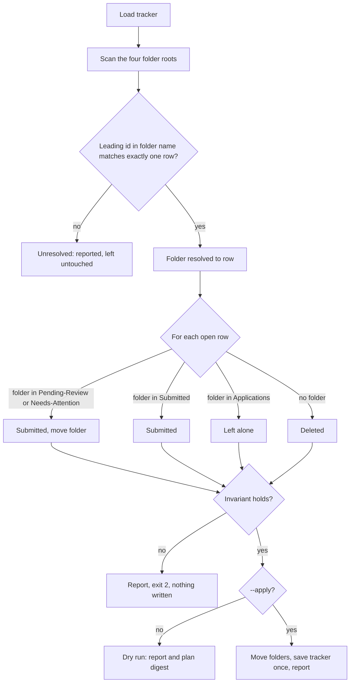

# Architecture

How ohmyjob is put together. Exact names, formats and conventions that scripts, hooks and tests share are in [CONTRACTS.md](CONTRACTS.md); the Claude Code behaviour the design relies on is in [platform-checks.md](platform-checks.md).

## Principle: agents decide, scripts keep the books, hooks enforce

- **Agents (LLM)** judge and act: a master runs the steps and starts workers; each worker handles one job.
- **Scripts** do all bookkeeping: queues, briefs, result checks, job notes, folder moves, tracker rows, follow-up questions, cleanup. A master calls them through one command, `ohmyjob`.
- **Hooks** run on every tool call they match; an agent cannot skip them. They allow, refuse or rewrite a call and save what the scripts need.

## Components

### Skills (`skills/`, commands are `/ohmyjob:<name>`)

| Skill | Role |
|---|---|
| `setup` | Idempotent preparation and health check: version gate, plugin-scope and Chrome checks (Chrome is a warning only), bootstrap (scoped installs, the `ohmyjob/` skeleton, mock templates, `Template.pdf`), extension steps, then it prints what the user fills in. It never interviews and never writes the user's data. |
| `master-resume` | Runs `ohmyjob resume master`: a script merges the resume yamls and extracts PDF text into a draft of `# Resume`; Claude adds the PDF facts; `--apply` saves it into Profile.md after a backup. |
| `build-resumes` | Runs `ohmyjob resume build-all`: a PDF next to every yaml in `Default_Resume_Files/`; reports `OK`, `OVERFLOW` or `FAIL` per file. Never edits a yaml. |
| `find-jobs` | Runs `ohmyjob scrape` in the background and summarizes (also usable from a scheduled `claude -p`). |
| `prep-jobs` | Forks the `prep-master` agent. |
| `apply-jobs`, `continue-applying` | Thin skills in the main session: call their `-run` skill, then ask the collected follow-up questions in one message and save the answers. |
| `apply-jobs-run`, `continue-applying-run` | Internal; fork the `application-master` agent (the second in continue mode). |
| `reconcile` | Dry run, confirmation, then apply. |

### Agents (`agents/`, named `ohmyjob:<name>`)

| Agent | Model | Job |
|---|---|---|
| `prep-master` | Haiku | Loops on `ohmyjob prep next` and starts the workers it prints. Cannot read files or pages. |
| `screen-worker` | Haiku | Scores one job against the text catalog of the usable resumes; reads only its brief; reports one JSON object. |
| `resume-worker` | Sonnet | Tailors one resume yaml (or rejects a mis-matched posting before any edit); the only command it may run is the build of its own job. |
| `application-master` | Sonnet | Runs the apply steps through `ohmyjob apply` and starts workers; its browser tools are limited to tab handling and the sign-in check. |
| `application-worker` | Sonnet | Fills one application in one assigned tab, from its brief; stops before the final button; reports one JSON object. |

Plugin agents ignore `permissionMode`, so a hook returns an explicit allow for every call it has validated. The `tools: Agent(...)` entry in an agent's frontmatter does not restrict what it can start, so the guards check the requested agent type themselves.

### Scripts (`scripts/`, run through `bin/ohmyjob`)

| Command | Script | Job |
|---|---|---|
| `ohmyjob scrape` | `scrape.py`, `scrape_core.py` | Search, filter, dedupe, write job folders and tracker rows. |
| `ohmyjob prep <cmd>` | `pj.py` (hooks: `pj_hooks.py`) | Prep queue, briefs, yaml checks, build, records. |
| `ohmyjob apply <cmd>` | `aa.py`, `aa_lib.py` (hooks: `hooks.py`; `judge.py`, `lexicon.py`) | Apply queue, briefs, result checks, tab groups, questions. |
| `ohmyjob reconcile` | `reconcile.py` | Tracker versus folders. |
| `ohmyjob resume build`, `build-all` | `resume_build.py` | Render one yaml (or every yaml of a folder) to LaTeX, run `lualatex`, count pages. |
| (internal) | `workspace.py`, `tracker.py`, `job_key.py` | Config and paths, the xlsx tracker, the one job-id rule. |
| (internal) | `hook.sh`, `bootstrap.sh`, `pii_gate.sh` | Hook router, environment setup, release check. |

`bin/ohmyjob` finds the workspace, reads `.ohmyjob/env.sh` (parsed, never sourced) and runs the script with the plugin's own virtualenv. Errors are one `ohmyjob: ...` line (exit 3); the scripts print `FATAL ...` lines. Agent prompts stop on either.

### Scraper

For each board in `search.sources`, in order, JobSpy is asked for every search term. A posting is kept when its title matches a term (word forms and aliases applied, or any title with `title_filter: off`), its employment type and company pass, it is not known yet (tracker row or a folder with the same job key) and it is not a twin of a posting from an earlier board or of a recent tracker row. Each new job gets `Applications/<key>_<Company>_<Title>/job.md` and a tracker row at `Found`. A board that fails is reported and skipped; the others run.

### Helper extension (`chrome-extension/`)

A small MV3 extension. In a run's tab group it opens page pop-ups (sign-in windows) as tabs, which Claude in Chrome can then control; it labels icon-only "Continue with Google" buttons; and at the end of a run it moves finished job tabs into the tab groups "Pending Review" and "Needs Attention", and moves fixed tabs back for `continue-applying`. It acts only for pages the master loads and only for tabs of the run group.

### Resume build (`resume/`, `resume_build.py`)

One complete yaml per resume (no shared base file; `Template.yaml` is the annotated starting point) is rendered through `resume.tex.j2` and compiled with LuaLaTeX using the vendored Awesome-CV class, in its own directory per build so parallel builds do not collide. The result is `OK`, `OVERFLOW` (more pages than `resume_max_pages`) or `FAIL`; character budgets for bullets and skill rows are checked before compiling. Every build uses `texmf-var/` in the plugin data folder for the LaTeX font caches.

## Hook routing and the guard model

Hooks are declared in `hooks/hooks.json` and all enter through `scripts/hook.sh <event>`:

| Event | Fires on | Does |
|---|---|---|
| `guard` | PreToolUse of Chrome tools, Read, Edit, Write, Bash, Agent | Allow, deny or rewrite. |
| `handback` | PreToolUse of `SubagentHandback` | Checks a worker's report; refuses a bad one (twice at most). |
| `snapshot` | PostToolUse of Chrome tools | Saves each page and its element refs; compacts long pages for the application worker. |
| `capture` | SubagentStop of an ohmyjob worker | The same report checks on the worker's final text. |
| `report` | Stop | Shows the usage table if the user has not seen it. Runs 2 to 3 times per run, so it is idempotent. |

A worker's report reaches the scripts by two equal paths, `handback` (auto mode only) and `capture` (the only path in Manual and `-p` mode). Both feed one processor.

Routing rules, in order (full text in CONTRACTS.md):

1. **Workspace discovery** is one rule for `find_root`, `hook.sh`, `bin/ohmyjob` and the Python hooks: `$OHMYJOB_WORKSPACE` as given (tests), else walk up from the start folder (the project folder, the call's `cwd` or the shell's `cwd`); in each folder D, `D/ohmyjob.json` makes D the workspace, else `D/ohmyjob/ohmyjob.json` makes `D/ohmyjob` the workspace. So the project folder and a shell inside `ohmyjob/` both work.
2. `hook.sh` stays in bash and starts no Python unless it must. Outside a workspace it exits 0 with no output.
3. A `guard` of any Chrome tool goes to `hooks.py`, whoever calls. The main session and non-ohmyjob subagents get the rules for callers outside the pipeline: no `javascript_tool`; clicks only on refs from a fresh read of that tab, one pressable click per read; no coordinate clicks; no Enter, Return or Space keys; navigation to http(s) addresses only; no Apply click on a job board or under a filled form; final button names checked by the word lists.
4. Other calls with a prep agent type go to `pj_hooks.py`; with an application agent type go to `hooks.py`. The main session's non-Chrome calls and other agents' non-Chrome calls cost nothing.
5. The model controls `tool_input`, so the Python hooks decide only from the parsed top-level `agent_type`, `tool_name` and `cwd`, never from text inside `tool_input`. Each script re-checks the parsed agent type and hands over to the other when the prefilter picked wrongly.
6. Without the plugin's virtualenv, `guard` of any ohmyjob agent and of any Chrome call by an agent is denied with `ohmyjob: environment missing or stale, run /ohmyjob:setup`; the main session's Chrome call only gets a notice (fail-open, because no pipeline can run before setup). The guard is `onFailure: block`, so a crash blocks the call too.

What the guards enforce:

- **Prep agents** stay inside their own job: a screen worker reads only its brief; a resume worker reads its brief, yaml and PDF, edits only its yaml and runs only the build of its job. A master may start only its own worker types.
- **Application worker**: only its own tab (and its sign-in tab); no coordinate clicks, Enter or Space keys, or JavaScript; every click carries an English action note; refs of an old page are refused; a second click on the same element before a new page read is refused; typing only after a click on a text field; uploads only of the job's own resume; reads only its brief and the ATS notes in `ats/`.
- **Mock guard**: `scrape` refuses while `ohmyjob.json` or `Profile.md` holds the `OHMYJOB-TEMPLATE` marker; `prep start` while `Profile.md` holds it or no usable resume is left; `apply start` (also continue mode) while `Profile.md` holds it. The check is one helper, `has_template_marker` / `template_files` in `workspace.py`. Each refusal is one `FATAL:` line naming the file.
- **Final controls** are refused in about 50 languages (word lists in `lexicon.py`), as is a submit button without a name; once a tab has shown a form, every Apply button is refused. For application workers (and for Apply clicks on job boards), a name that no list can decide goes to a Haiku check (`judge.py`, one cached `claude -p` call with no tools); if it fails, the click is refused. Callers outside the pipeline use the word lists only.
- **Consent and sign-in**: cookie banners get the most private choice; OAuth permission grants are refused; on a Google account page only the account choice and the basic-profile consent are allowed; sign-up and delete buttons are refused.
- **Application master**: tab handling and the sign-in check only, and only the application worker agent type.

## Queues

Both masters are queue loops: a new worker starts as soon as one finishes, up to `max_parallel_workers` (capped below Claude Code's subagent limit by one for the master). The master must keep its turn alive with the `next` loop; a forked master that ends its turn after launching background workers stops at once.

### Prep (`ohmyjob prep`)

1. `start` refuses on the mock guard (above), builds the screening catalog, queues `Found` rows for screening and `Matched` rows for building, and pairs rows with folders by the job id. A row without a folder becomes `Deleted`; a folder without a row gets a `Found` row; duplicate postings (same company and title) become `Deleted`, keeping a `Resume Built` row, then one with a stated location, then the lower id.
2. `next` is the loop: it records finished jobs and prints the workers to start. `assign-screen` writes one brief per job (full `Profile.md`, the path of the catalog text, the job). Screen workers report a match score, the matched resume, reasons and gaps.
3. `record` writes the result into `job.md`, sets the row, saves the tracker, and only then deletes skipped folders. A match on a yaml sets `Matched` and joins the build queue at once. A match on a ready-made PDF needs no worker: `record` copies the PDF into the job folder as `<First>_<Company>_<Title>.pdf` and sets `Resume Built` directly; such a folder holds a PDF and no yaml. A skip sets `Skipped-LowFit`.
4. `assign-build` copies the matched yaml into the job folder and writes the brief. The resume worker edits only that yaml and runs `ohmyjob prep build <job>`, which checks the mechanical rules (skeleton, bullet counts, title, line and skills budgets), compiles (at most 4 builds), and returns `OK`, `OVERFLOW` or `FAIL`. `record` then sets `Resume Built`, `Resume Failed`, or `Deleted` for a rejected posting.
5. `end` prints the summary (every deletion listed one by one) and the token table, and deletes the run folder.

Order of writes in every step: `job.md`, then the tracker (saved), then folder deletions. A folder is deleted only after its row is saved. A worker has a time limit; a job with no report after a further wait is recorded as missing. A crashed run is harmless: unrecorded jobs are still at `Found` or `Matched` and the next run takes them again.

### Apply (`ohmyjob apply`)

1. `start` clears old run state and queues rows at `Resume Built` (`--continue`: rows at `Needs Attention` whose tab can be found). `preflight` checks the LinkedIn sign-in, the helper extension and the Haiku check.
2. The master opens one tab per job; `assign` writes one brief per job: the full `Profile.md`, the tailored resume yaml and the job's overview and description.
3. `next` starts workers in free slots; the first page loads are staggered so that many workers do not hit one account at once. Each worker's report is checked by `handback` or `capture`.
4. A worker never guesses. On a question about the candidate that the brief does not answer, it stops with status `blocked` and the questions word for word; `finish` records them in `questions.json`, and the main session asks them and saves the answers in `Profile.md` (`ohmyjob apply questions` / `answer`).
5. `finish` checks every result, writes `job.md` notes, moves folders (`Pending-Review/` for a form parked at the final step, `Needs-Attention/` for the rest) and updates the tracker in one save. `group-plan` and `cleanup-plan` let the extension group the tabs and close stray ones (job tabs stay open). `end` prints the token table and removes the run folder.
6. `continue` mode (`adopt-plan`, `adopted`, `assign --continue`) takes the tabs the candidate fixed by hand back into the run group; each worker continues from the open page. Tabs are matched by Chrome's tab id, so after a Chrome restart those jobs are left alone.

A worker that is stopped by an upload hang (a hidden browser alert) is retried once with a shortened file name.

## State and files

The workspace is the `ohmyjob/` folder inside the project folder (the folder Claude starts in, which also holds `.claude/settings.json`). In it:

| Path | Content |
|---|---|
| `ohmyjob.json` | Config and the workspace marker; hooks do nothing without it. Its `_template` key (the only extra key accepted) means "not edited yet". |
| `Profile.md` | `# Fit Preferences` (three fields, screened against first), `# Resume` (the master resume; its `- Name:` line gives the file prefix), `# Follow Up Questions` (numbered). A first line with `OHMYJOB-TEMPLATE` means mock data. |
| `Job_Tracker.xlsx` | One row per job: Job URL, Status, Company, Job Title, Date Found, Location, Source, Match Score, Notes. Statuses: `Found`, `Matched`, `Skipped-LowFit`, `Resume Built`, `Resume Failed`, `Pending Review`, `Needs Attention`, `Submitted`, `Deleted`. |
| `Default_Resume_Files/` | `Template.yaml` and `Template.pdf` (never used for jobs); one complete `<Field>.yaml` per resume with its built `<Field>.pdf`; optional ready-made `<Field>.pdf` without a yaml. Named by field by the user; never edited by the pipeline. |
| `Applications/`, `Pending-Review/`, `Needs-Attention/`, `Submitted/` | One folder per job named `<job_key>_<Company>_<Title>`, holding `job.md`, the tailored yaml and PDF. |
| `.ohmyjob/` | `env.sh`, run state (`run/prep`, `run/apply`), `build/`, `catalog/` (the screening text catalog), `questions.json`, `last_report.txt`. Do not edit. |
| `.claude/settings.json` | Plugin enablement, environment, the `Bash(ohmyjob *)` allowance and the `javascript_tool` deny; merged by setup. |

In the plugin data folder (`${CLAUDE_PLUGIN_DATA}`, survives updates): the virtualenv, uv's own Python and cache, `uv` if it was missing, TinyTeX if no system LaTeX built the template, the LaTeX font caches (`texmf-var/`) and a stable copy of the extension. Nothing is installed on the user's `PATH`, in `~/.local`, in `~/.cache` or in a system folder; `bin/ohmyjob` and the resume build pass the same scoped `UV_*` and `TEXMF*` settings to every later run. Its path depends on how the plugin is loaded, which is why setup writes it into `env.sh` on every run.

Job id: a LinkedIn `/jobs/view/<id>` keeps its id; any other address gives `9` plus 14 hash digits, with tracking parameters ignored. One rule (`job_key.py`) serves the scraper, the folders and reconcile. The tracker is saved atomically; a save is refused while Excel or LibreOffice has the file open, or when the file changed on disk since the run loaded it.

## Reconcile

Matching is by the leading job id of each folder name against the id of the row's Job URL. For every open row (`Found`, `Matched`, `Resume Built`, `Resume Failed`, `Pending Review`, `Needs Attention`):

| Where the folder is | Result |
|---|---|
| `Pending-Review/` or `Needs-Attention/` | Row becomes `Submitted`; folder moves to `Submitted/`. |
| `Submitted/` | Row becomes `Submitted` (nothing moves). |
| `Applications/` | Left alone; the job is not reviewed yet. `Applications/` is never touched. |
| nowhere | Row becomes `Deleted`. |

`Deleted`, `Skipped-LowFit` and `Submitted` rows are never rewritten (a `Submitted` row only gets a stray folder moved), but all rows take part in matching and in the invariant. A row whose id is shared by several rows, or whose folder is claimed twice, is left untouched and reported. Folders without a leading id are ignored.

Invariant: the number of `Submitted` rows equals the number of folders in `Submitted/` after the planned changes. If it fails, nothing is written (exit 2).

Exit codes: 0 clean, 1 done but some folder unresolved, 2 invariant failed (nothing written), 3 fatal. The dry run prints a plan digest; `--apply --expect <digest>` refuses when the plan changed since.

## Token usage

`end` of the prep and apply runs prints one table per agent type and model (agents, API calls, input, cache write, cache read, output tokens), summed from the transcripts Claude Code writes for the master and every worker it started, plus the Haiku checks. The text may be dropped on its way to the user, so it is also saved to `.ohmyjob/last_report.txt`, and the `report` hook shows it if the user has not seen it.
